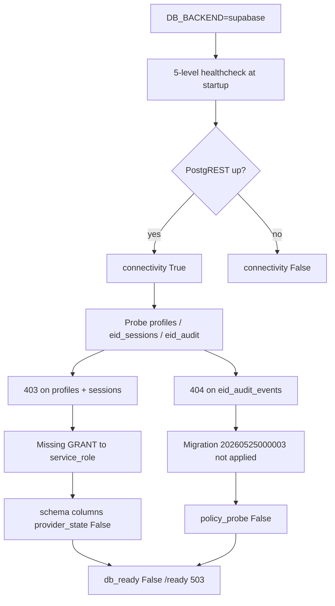

# Supabase startup: `db_ready=False` — рассинхрон схемы и привилегий

> **Дата:** 2026-06-27  
> **Методология:** [`analysis.mdc`](../../../.cursor/rules/analysis.mdc) — claims только с путями к коду/логам  
> **Триггер:** `make dev` / uvicorn startup, проект `ydocxoquirltrrfmvpqz.supabase.co`  
> **Статус:** 🔴 **анализ закрыт, fix отложен** — требуется operator repair в Supabase SQL Editor + follow-up PR на миграции/runbook

---

## TL;DR

На старте identity с `DB_BACKEND=supabase` **PostgREST доступен** (`connectivity=True`), но **4 из 5 healthcheck-уровней падают**. Это **не** «сломанный Supabase URL» и **не** crashloop — сервер поднимается в degraded mode (`/ready` → 503), как задумано ([`dependencies.py:94-101`](../../src/core/api/dependencies.py)).

Фактически обнаружены **две независимые проблемы** в remote БД:

| # | Симптом | HTTP | Интерпретация |
|---|---------|------|---------------|
| A | `profiles`, `eid_verification_sessions` — SELECT через service_role | **403** `42501 permission denied` | Таблицы **существуют**, но у роли `service_role` **нет table-level GRANT** (RLS-политики есть, GRANT — нет) |
| B | `eid_audit_events` — POST health probe | **404** `PGRST205 Could not find table` | Таблица **не создана** в public schema; PostgREST подсказывает `phone_audit_events` → в БД уже есть **phone-миграции**, core eID audit — **нет** |

**Вывод:** partial / out-of-order bootstrap — оператор применил **не полный** набор миграций (вероятно phone/oauth без полного core + без GRANT). Документация runbook **устарела** (§3 перечисляет только миграции 1–4, тогда как код и bootstrap ждут 8 operational файлов).

---

## Runtime evidence (startup log)

Источник: terminal `make dev`, 2026-06-27 ~15:00.

```text
supabase_request_error … profiles status=403 … "permission denied for table profiles"
  hint: GRANT SELECT ON public.profiles TO service_role

supabase_request_error … eid_verification_sessions status=403 … permission denied

supabase_request_error … eid_audit_events status=404 … Could not find the table 'public.eid_audit_events'
  hint: Perhaps you meant the table 'public.phone_audit_events'

startup.persistence_backend backend=supabase db_ready=False
  db_checks={'connectivity': True, 'schema': False, 'columns': False,
             'provider_state': False, 'policy_probe': False}
```

### Mapping log → healthcheck

Код: [`db_supabase.py:306-369`](../../src/core/infrastructure/db_supabase.py), сборка: [`dependencies.py:94-100`](../../src/core/api/dependencies.py).

| `db_checks` key | Метод | Запрос | Ожидание | Факт в логе |
|-----------------|-------|--------|----------|-------------|
| `connectivity` | `healthcheck()` | `GET /rest/v1/?limit=1` | 2xx | ✅ (нет error line) |
| `schema` | `required_tables_ready()` | `GET /rest/v1/{table}?limit=1` для `profiles`, `eid_verification_sessions`, `eid_audit_events` | все 2xx | ❌ 403 на profiles/sessions; 404 на audit |
| `columns` | `required_columns_ready()` | `GET /rest/v1/profiles?select=…` | 2xx | ❌ 403 (та же таблица) |
| `provider_state` | `provider_state_ready()` | `GET …/eid_verification_sessions?select=provider,…` | 2xx | ❌ 403 |
| `policy_probe` | `service_role_policy_probe()` | `POST` + `DELETE` `eid_audit_events` | 2xx | ❌ 404 (таблица отсутствует) |

`_REQUIRED_TABLES` **не** включает `story_drafts` (исправлено после [`epic-ids-05-scope-validation-2026-06-03.md`](./epic-ids-05-scope-validation-2026-06-03.md)) — текущий сбой **не** связан с G1 из того аудита.

---

## Гипотезы (debug)

| ID | Гипотеза | Вердикт | Evidence |
|----|----------|---------|----------|
| **H1** | Core-таблицы не созданы | **REJECTED (частично)** | `profiles` / `eid_verification_sessions` → 403, не 404 → таблицы есть |
| **H2** | Нет `GRANT … TO service_role` на существующих таблицах | **CONFIRMED** | Postgres hint в 403; grep `supabase/` → **0** строк `GRANT` |
| **H3** | `eid_audit_events` не применена (partial migrations) | **CONFIRMED** | 404 PGRST205; hint на `phone_audit_events` |
| **H4** | Неверный `SUPABASE_SERVICE_ROLE` (anon key) | **REJECTED** | anon обычно даёт другие ошибки; connectivity OK; hint явно про GRANT |
| **H5** | Runbook/bootstrap drift — оператор применил неполный набор | **CONFIRMED** | [`supabase-project-setup.md` §3](../runbook/supabase-project-setup.md) — только миграции 1–4; код PV-09/OAuth ждёт 5–8 |

---

## Root cause (compound)



### A. Missing table-level privileges (403)

Миграции создают **RLS policies** для `service_role` ([`20260525000001_create_profiles.sql:72-77`](../../supabase/migrations/20260525000001_create_profiles.sql)), но **ни одна миграция не содержит `GRANT`**.

В PostgreSQL RLS **не заменяет** table privileges. PostgREST под `service_role` JWT всё равно требует `GRANT SELECT/INSERT/… ON public.<table> TO service_role`. Supabase SQL Editor иногда выдаёт hint именно в этом формате.

**Почему могло «раньше работать»:** таблицы созданы через Dashboard (default grants), или полный `000_full_init.sql` на другом проекте, или ручной GRANT уже был.

### B. Missing `eid_audit_events` (404)

Миграция [`20260525000003_create_eid_audit_events.sql`](../../supabase/migrations/20260525000003_create_eid_audit_events.sql) **не применена** к этому проекту.

Косвенное доказательство partial state: PostgREST знает `phone_audit_events` ([`20260626000001_phone_persistence_tables.sql`](../../supabase/migrations/20260626000001_phone_persistence_tables.sql)) — значит **хотя бы phone-миграция применена**, а core audit — нет. Типичный сценарий: применили «хвост» миграций (phone/oauth) без миграций 1–3 или без audit (#3).

---

## Документационный drift (сопутствующий риск)

| Документ | Проблема |
|----------|----------|
| [`runbook/supabase-project-setup.md` §3](../runbook/supabase-project-setup.md) | Перечисляет только миграции **1–4**; нет phone (6), oauth (7–8), phone persistence (9) |
| [`requirements/08-supabase-migrations.md`](../requirements/08-supabase-migrations.md) | В дереве **8 файлов**, но **нет** `20260626000001_phone_persistence_tables.sql` в списке (PV-09) |
| [`runtime-docs/02-data-bootstrap.md`](../runtime-docs/02-data-bootstrap.md) | Таблица миграций обрывается на #4; bootstrap comment про `story_drafts` в healthcheck **устарел** |
| [`supabase/bootstrap/000_full_init.sql`](../../supabase/bootstrap/000_full_init.sql) | Актуален (8 блоков), но **без GRANT** — та же дыра при чистом bootstrap |

---

## Operator repair (выполнить в Supabase SQL Editor)

**Не автоматизировано в коде** — осознанный operator step. Полный скрипт: [`../runbook/supabase-schema-repair-grants-and-core-tables.sql`](../runbook/supabase-schema-repair-grants-and-core-tables.sql).

### Шаг 0 — диагностика (read-only)

```sql
-- Какие identity-таблицы есть
SELECT tablename
FROM pg_tables
WHERE schemaname = 'public'
  AND tablename IN (
    'profiles', 'eid_verification_sessions', 'eid_audit_events',
    'phone_verification_sessions', 'phone_audit_events',
    'oauth_authorization_requests', 'oauth_authorization_codes'
  )
ORDER BY 1;

-- Есть ли GRANT для service_role (пример для profiles)
SELECT grantee, privilege_type
FROM information_schema.role_table_grants
WHERE table_schema = 'public' AND table_name = 'profiles';
```

### Шаг 1 — создать отсутствующие core-объекты

Если `eid_audit_events` нет — выполнить **целиком** файлы по порядку (пропустить уже существующие):

1. `20260525000003_create_eid_audit_events.sql` (если нет таблицы)
2. При отсутствии колонок provider — `20260526000001_eid_sessions_provider_abstraction.sql`

**Рекомендуется** на «грязном» проекте: сверить с [`000_full_init.sql`](../../supabase/bootstrap/000_full_init.sql) блоками, а не cherry-pick.

### Шаг 2 — GRANT для service_role (403 fix)

```sql
GRANT SELECT, INSERT, UPDATE, DELETE ON public.profiles TO service_role;
GRANT SELECT, INSERT, UPDATE, DELETE ON public.eid_verification_sessions TO service_role;
GRANT SELECT, INSERT, UPDATE, DELETE ON public.eid_audit_events TO service_role;
-- + все operational таблицы из bootstrap (oauth_*, phone_*)
```

### Шаг 3 — перезапуск + verify

```bash
cd doge-identity-service
make serve
# ожидание: db_ready=True, все db_checks True

curl -s http://localhost:8100/ready | python3 -m json.tool
```

Connectivity snippet: [`supabase-project-setup.md` §Connectivity](../runbook/supabase-project-setup.md).

---

## Рекомендуемые follow-up (отдельная задача, не в этом fix)

| Приоритет | Задача | Зачем |
|-----------|--------|-------|
| **P0** | Operator repair по runbook SQL | Разблокировать dev/staging проект |
| **P1** | Добавить блок `GRANT … TO service_role` в каждую create-миграцию + `000_full_init.sql` | Предотвратить 403 на новых проектах |
| **P1** | Обновить `supabase-project-setup.md` — полный ordered list (1–8 + PV-09) или «используйте только `000_full_init.sql`» | Убрать partial bootstrap |
| **P2** | Sync `req-08`, `02-data-bootstrap` с фактическими 9 migration files | Doc drift |
| **P2** | Расширить startup log / `/ready` — per-check failure reason (status + table) | Быстрая диагностика без grep stderr |
| **P3** | Рассмотреть `supabase db push` как канон после `supabase link` | Меньше human error в SQL Editor |

**Не меняем в этом анализе:** код healthcheck thresholds, переключение probe на `phone_audit_events` — это другой продуктовый вопрос; probe **намеренно** бьёт в `eid_audit_events` ([`db_supabase.py:349-367`](../../src/core/infrastructure/db_supabase.py)).

---

## Debug instrumentation (session 3c4b9a)

~~Временные NDJSON-логи в `db_supabase.py`~~ — **удалены** после подтверждения operator repair (2026-06-27).

---

## Связанные документы

- [`epic-ids-05-scope-validation-2026-06-03.md`](./epic-ids-05-scope-validation-2026-06-03.md) — исторический контекст `story_drafts` / healthcheck
- [`runbook/supabase-project-setup.md`](../runbook/supabase-project-setup.md) — текущий (неполный) bootstrap guide
- [`runtime-docs/02-data-bootstrap.md`](../runtime-docs/02-data-bootstrap.md) — 5-level `/ready` contract
