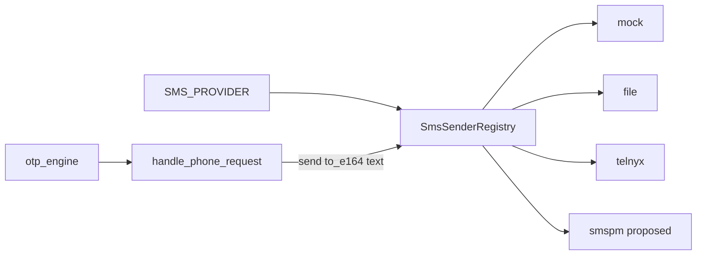

# Solution architecture: SMSPM as SMS delivery provider

> **Status:** proposed / **not implemented** in `src/`  
> **Date:** 2026-08-16  
> **Method:** [`.cursor/rules/analysis.mdc`](../../../../../.cursor/rules/analysis.mdc) — as-is claims cite code; SMSPM API claims cite inbound guide  
> **Audience:** implementers of a new live SMS option for Estonian OTP delivery  
> **Scope of this doc:** design only. No code, runbook, INDEX, or dashboard changes in this wave.  
> **Decisions locked (2026-08-16):** D-G1…D-G6 и story-level decisions — в [`EPIC-IDS-SMSPM.md`](EPIC-IDS-SMSPM.md) и story-файлах пакета; SA не дублирует таблицу.

---

## 1. Goal / non-goals

### Goal

Add **SMSPM** as a selectable live SMS delivery backend for phone OTP verification, switched via `.env`:

```env
SMS_PROVIDER=smspm
```

so that Estonian numbers (`PHONE_ALLOWED_DIAL_PREFIXES=+372`) can receive real SMS when Telnyx account/geo is unsuitable.

### Non-goals

- Replace our OTP engine with any SMSPM “verify” product — identity keeps generation, `code_hash`, TTL, attempts ([`otp_engine.py`](../../../../src/core/phone/otp_engine.py)).
- Remove or disable **Telnyx** — it stays a configured option (`SMS_PROVIDER=telnyx`).
- Change spa / gateway / public privacy copy in this wave.
- Implement delivery webhooks as a gate for `/auth/phone/confirm` (observability only, same posture as Telnyx).

---

## 2. As-is: multi-provider SMS already exists

Verified in code:

| Concern | Fact | Anchor |
|---------|------|--------|
| Send port | `SmsSenderPort.send(*, to_e164, text) -> SmsSendResult` | [`base.py:38-42`](../../../../src/core/phone/base.py) |
| Registry | `ALL_SMS_PROVIDER_DESCRIPTORS` = `mock`, `file`, `telnyx` | [`registry_builder.py:10-14`](../../../../src/core/phone/registry_builder.py) |
| Switch | `SMS_PROVIDER` must be in `registered_sms_provider_names()` | [`schema.py:168-176`](../../src/core/config/schema.py) |
| Active build | registry registers `mock` + active name; `get_active(config)` | [`registry_builder.py:27-40`](../../../../src/core/phone/registry_builder.py), [`registry.py`](../../../../src/core/phone/registry.py) |
| OTP ownership | core creates session + plaintext code; sender only delivers | [`otp_engine.py`](../../../../src/core/phone/otp_engine.py), [`handlers.py`](../../../../src/core/api/handlers.py) `handle_phone_request` |
| Telnyx package pattern | `config` + `descriptor` + `sender` + `errors` | [`src/core/phone/telnyx/`](../../../../src/core/phone/telnyx/) |

Operator runbook for mock / Telnyx switch: [`phone-sms-verification.md`](../../../runbook/phone-sms-verification.md) (`SMS_PROVIDER=mock|telnyx` in §2; live Telnyx in §6).

**Implication:** SMSPM is **not** a new architecture — it is another `SmsProviderDescriptor` next to Telnyx.



---

## 3. Target: SMSPM as `SmsSenderPort`

### 3.1 Runtime selection (future)

When implemented:

1. Add `SMSPM_SMS_DESCRIPTOR` with `name="smspm"`.
2. Append it to `ALL_SMS_PROVIDER_DESCRIPTORS` in [`registry_builder.py`](../../../../src/core/phone/registry_builder.py).
3. Operator sets `SMS_PROVIDER=smspm` plus SMSPM env vars; startup fail-fast via `config_spec.validate` (same path as Telnyx: [`schema.py:115-176`](../../../../src/core/config/schema.py)).

Telnyx remains registered and selectable; no migration of existing Telnyx env vars.

### 3.2 Call path (unchanged)

```
POST /auth/phone/request
  → normalize E.164
  → create_phone_verification_session (hashes only in DB)
  → registry.get_active(config).send(to_e164=e164, text=sms_text)
  → store provider_message_id if present
```

Confirm path does not call SMSPM — local OTP verify only.

---

## 4. SMSPM API mapping (from inbound guide)

**Source:** [`inbound/SMSPM_SMS_Delivery_Integration_Guide.md`](../inbound/SMSPM_SMS_Delivery_Integration_Guide.md) (API v2.1, base `https://api.smspm.com`).

### 4.1 Authentication

| Credential | Role | Guide |
|------------|------|-------|
| `hash` | Account API hash (semi-public identifier) | guide § Authentication |
| `token` | Secret API token (UUID-style) | guide § Authentication |
| `fromNumber` | Sender ID (alphanumeric ≤11 or numeric) | guide § Sender ID |

Auth is **in JSON body** (POST), not `Authorization: Bearer` (unlike Telnyx).

### 4.2 Send (MVP)

**Recommended:** `POST https://api.smspm.com` with `Content-Type: application/json`:

```json
{
  "hash": "<SMSPM_HASH>",
  "token": "<SMSPM_TOKEN>",
  "toNumber": "37256789045",
  "text": "Your Dogestonia verification code is 123456.",
  "fromNumber": "<SMSPM_FROM>"
}
```

Optional later: `"report": "<callback URL>"` for delivery callbacks.

**Success shape (guide):**

```json
{
  "messages": [
    {
      "id": "a7b3c4d5-e6f7-8a9b-0c1d-2e3f4a5b6c7d",
      "toNumber": "37256789045",
      "status": "Added to queue"
    }
  ]
}
```

Map `messages[0].id` → `SmsSendResult.provider_message_id`; `accepted=True` when HTTP success and id present (mirror Telnyx “queued/sent” acceptance).

### 4.3 Phone number format boundary

| Layer | Format |
|-------|--------|
| Identity core | E.164 **with** `+` (e.g. `+37256789045`) — [`e164.py`](../../../../src/core/phone/e164.py) |
| SMSPM API examples | digits **without** `+` (e.g. `37256789045`) — guide request examples |

**Design rule:** strip leading `+` only inside `SmspmSmsSender.send` when building `toNumber`. Do **not** change core E.164 normalization or DB hashing input (hashes stay on full E.164 with `+`).

### 4.4 Delivery tracking (phase-2, optional)

Guide offers:

- polling `/smsdetails` (or equivalent details endpoint);
- webhooks via `report` URL (status: queued → submitted → delivered/failed).

**MVP OTP:** treat successful enqueue as enough for verification UX (user enters code from SMS). Delivery webhook is observability, same as Telnyx `POST /webhooks/telnyx/messaging` (runbook §6: does not gate verification).

---

## 5. Proposed module layout (future code)

Mirror Telnyx package — **not created yet**:

```text
src/core/phone/smspm/
  __init__.py
  config.py       # SmspmSettings + SmspmSmsProviderConfigSpec + validate
  descriptor.py   # SMSPM_SMS_DESCRIPTOR
  sender.py       # SmspmSmsSender(SmsSenderPort)
  errors.py       # map HTTP/body → SmsSenderError
```

### 5.1 Proposed env vars

| Env | Required when `SMS_PROVIDER=smspm` | Notes |
|-----|-------------------------------------|-------|
| `SMSPM_HASH` | yes | API hash |
| `SMSPM_TOKEN` | yes | API token (secret) |
| `SMSPM_FROM` | yes | Sender ID (pre-approved in SMSPM dashboard) |
| `SMSPM_API_BASE_URL` | no | default `https://api.smspm.com` |
| `SMSPM_REPORT_URL` | no | optional webhook URL for phase-2 |

Fail-fast: if `SMS_PROVIDER=smspm` and hash/token/from empty → `ConfigError` via `config_spec.validate` (pattern: [`telnyx/config.py`](../../../../src/core/phone/telnyx/config.py)).

### 5.2 Descriptor registration (future one-liner set)

- Implement `SMSPM_SMS_DESCRIPTOR = SmsProviderDescriptor(name="smspm", config_spec=..., build=...)`.
- Add to `ALL_SMS_PROVIDER_DESCRIPTORS` tuple.
- Ensure HTTP client available on `SmsProviderRuntime` (Telnyx already requires `runtime.http_client`).

---

## 6. Error mapping → `SmsErrorCode`

Use the same domain codes as Telnyx ([`SmsErrorCode`](../../../../src/core/phone/base.py), pattern [`telnyx/errors.py`](../../../../src/core/phone/telnyx/errors.py)). Proposed mapping from guide error strings / HTTP:

| SMSPM / HTTP signal (guide) | Map to |
|-----------------------------|--------|
| HTTP 401 / `"Unauthorized"` / invalid credentials | `SEND_FAILED` or `PROVIDER_UNAVAILABLE` (prefer fail closed; do not leak auth detail to client) |
| `"Invalid phone number: …"` / too short | `INVALID_PHONE` |
| HTTP 429 (if observed) | `RATE_LIMITED` |
| HTTP 5xx / timeout | `PROVIDER_UNAVAILABLE` |
| Other 4xx validation (`Hash is required`, `Message text is required`, …) | `SEND_FAILED` |
| Unknown body | `UNKNOWN` |

Log provider-safe reason server-side; client still sees envelope `error.code` from our enum (handler already maps `SmsSenderError`).

Exact SMSPM error code table may be refined during implementation against live responses — guide documents string `error` fields more than numeric codes.

---

## 7. GDPR / custody boundary

Unchanged identity persistence model ([`10-phone-personal-data-processing.md`](../../../runtime-docs/10-phone-personal-data-processing.md)):

- DB stores **HMAC** of E.164 / OTP only.
- Plaintext number + OTP text leave our process on `sender.send` to **SMSPM** (processor), same class of transfer as Telnyx.
- Retention at SMSPM is **outside this repo** — needs their DPA / account settings when going live.

---

## 8. Implementation order (checklist, not stories)

1. `smspm/config.py` + validate required env.
2. `smspm/sender.py` POST send + `+` strip + `provider_message_id`.
3. `smspm/errors.py` mapping.
4. `smspm/descriptor.py` + register in `registry_builder`.
5. Offline tests with mocked `httpx` (mirror Telnyx sender tests).
6. Later: operator runbook section `SMS_PROVIDER=smspm` + smoke with real EE number.
7. Optional phase-2: `report` webhook ingest (separate from OTP confirm).

---

## 9. References

| Doc | Role |
|-----|------|
| [`inbound/SMSPM_SMS_Delivery_Integration_Guide.md`](../inbound/SMSPM_SMS_Delivery_Integration_Guide.md) | SMSPM API contract (external) |
| [`runbook/phone-sms-verification.md`](../../../runbook/phone-sms-verification.md) | Current mock/Telnyx operator smoke |
| [`src/core/phone/telnyx/`](../../../../src/core/phone/telnyx/) | Implementation template |
| [`phone-verification-architecture-2026-06-10.md`](../../../analysis/phone-verification-architecture-2026-06-10.md) | Product architecture for phone OTP |
| [`10-phone-personal-data-processing.md`](../../../runtime-docs/10-phone-personal-data-processing.md) | PII / HMAC custody |

---

## 10. Explicit “not in code yet”

Until implemented, the following are **false** if claimed as done:

- `SMS_PROVIDER=smspm` accepted by config
- package `src/core/phone/smspm/`
- SMSPM webhook route
- runbook mode C for SMSPM
